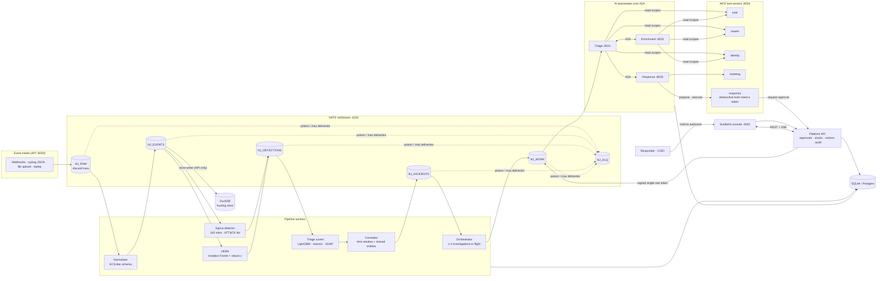
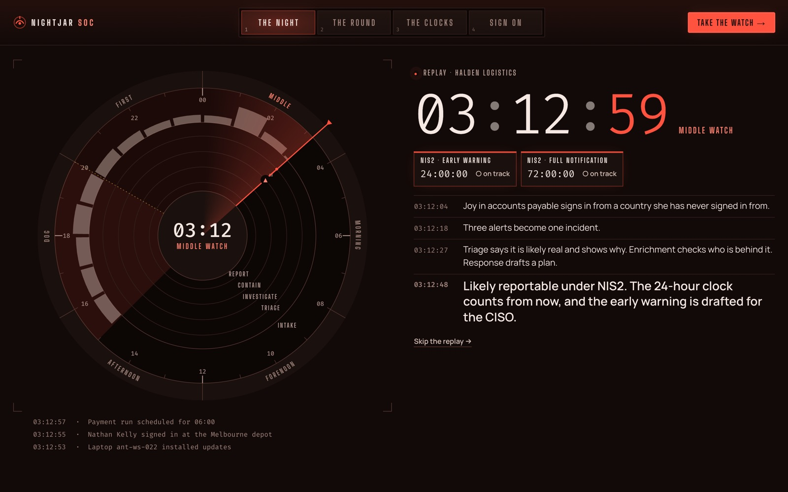
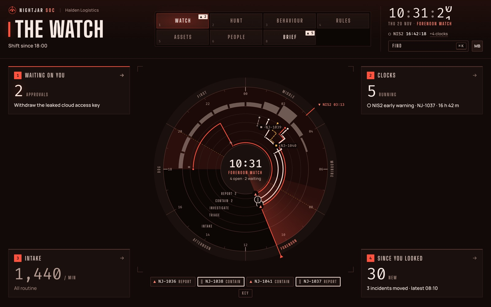
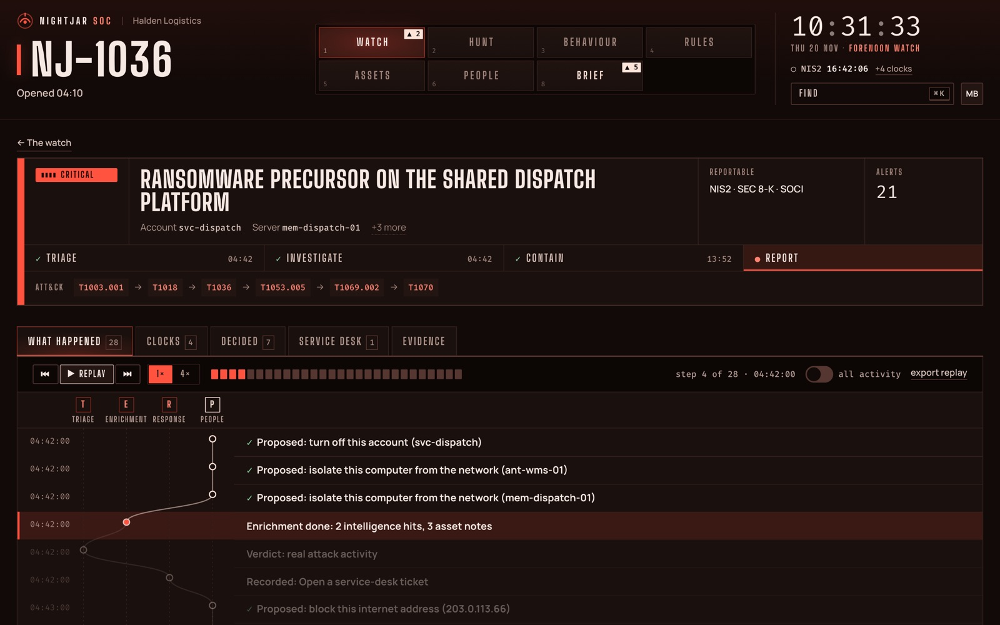
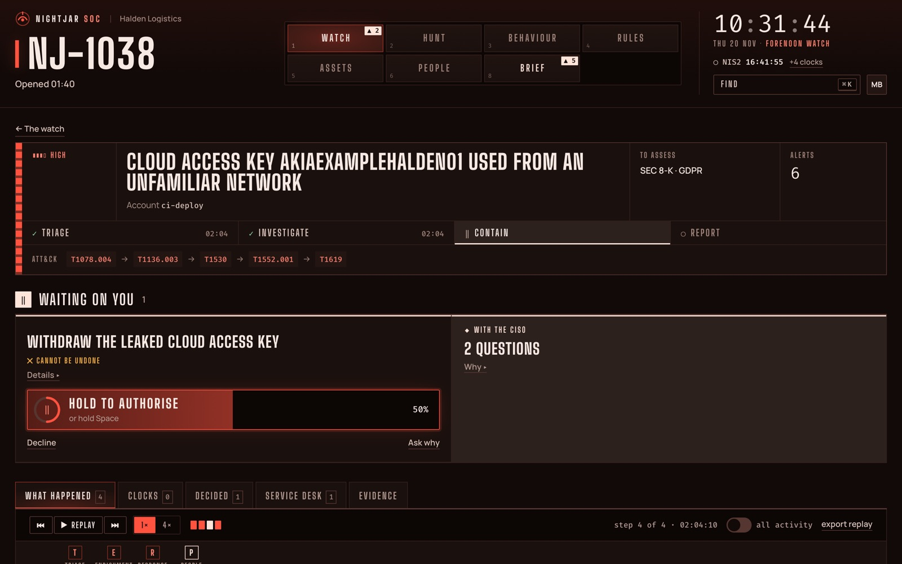
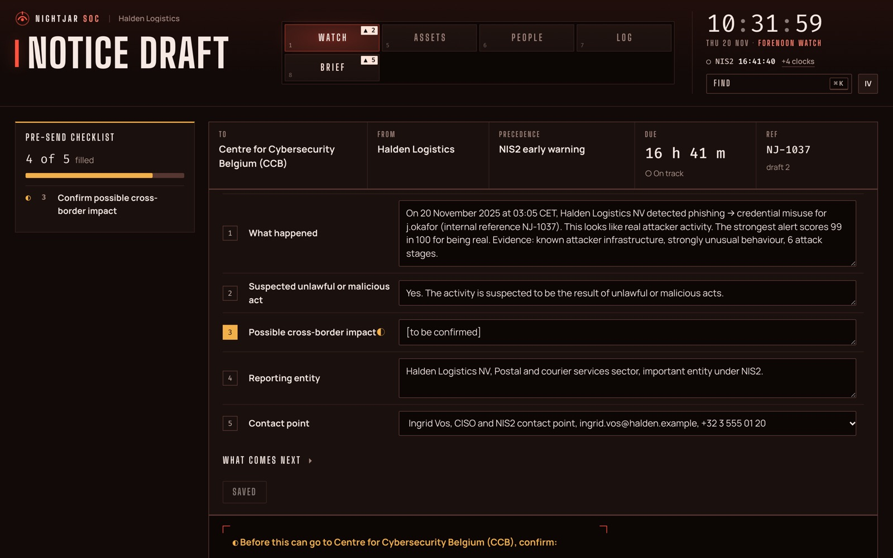
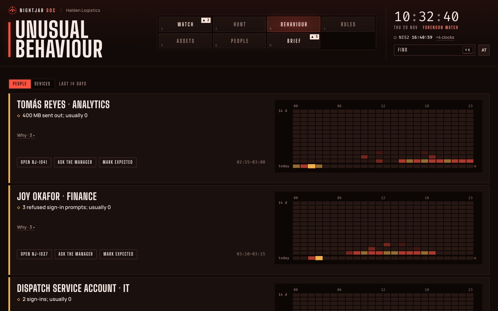
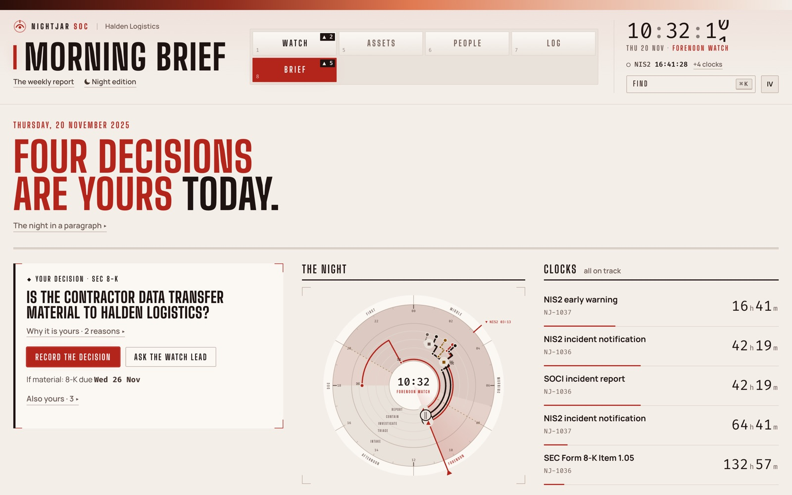
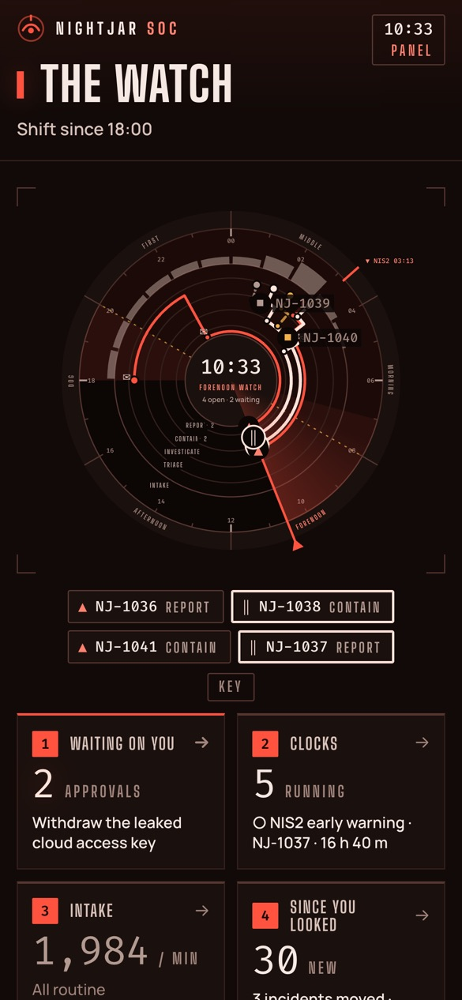

<div align="center">

# Nightjar SOC

**AI security operations for mid-size companies, with regulatory incident reporting.**

Nightjar SOC watches a company's security events around the clock. It groups alerts into incidents, separates real
threats from noise, and has three AI teammates investigate each incident. When something reportable happens, it
starts the regulator's clock and drafts the notice. A person approves every disruptive action.

[Problem statement](docs/PROBLEM_STATEMENT.md) · [Architecture](docs/ARCHITECTURE.md) · [API contract](docs/API_CONTRACT.md) · [Data sources](docs/DATA.md) · [Design decisions](docs/adr/) · [Evaluation](eval/RESULTS.md) · [Design](frontend/DESIGN.md)

</div>

---

## Why now

A company of 200 to 2,000 people usually has an IT manager, perhaps two security staff, and the same attackers as a
bank. Its tools raise thousands of alerts a day. Most are noise, and the few that matter tend to arrive at 3 a.m.
A round-the-clock analyst seat takes about five people to staff, before any tooling.

The reporting clock is now law in every region such a company is likely to operate in:

| Regime | Who it covers | Clock |
|---|---|---|
| **EU NIS2** (Directive (EU) 2022/2555, Art. 23; applies from 18 October 2024 through national law) | Essential and important entities in 18 sectors, including transport and postal and courier services | Early warning within **24 hours** of becoming aware of a significant incident, notification within **72 hours**, final report within **one month** |
| **US SEC Form 8-K Item 1.05** (in force since 18 December 2023) | Public companies | Disclose a material cybersecurity incident within **four business days** of determining that it is material |
| **Australia SOCI Act 2018, Part 2B** | Responsible entities for critical infrastructure assets, including critical freight services | **12 hours** for a significant impact on availability, **72 hours** for other relevant impacts |
| **EU GDPR Art. 33** | Any controller of personal data | Notify the supervisory authority of a personal data breach within **72 hours**, where feasible |

A logistics group with a Belgian subsidiary, a US listing and an Australian freight network answers to all four. Each
regime has its own trigger, its own clock and its own recipient. Missing an early warning because nobody connected
"unusual sign-in" to "significant incident" is a compliance failure on top of the breach.

| Instead of | Nightjar SOC does |
|---|---|
| A night of pages for a backup-software update | A **calibrated triage model** that scores every alert with plain reasons, so 146 alerts become one likely-benign incident |
| An analyst stitching together logs at 3 a.m. | **Three AI teammates** (Triage, Enrichment, Response) that investigate over an open agent protocol, with every step recorded and replayable |
| Automation with the keys to production | **Hold to authorise**: no host is isolated and no account disabled without a signed, single-use human approval. Crown-jewel systems need the CISO as well |
| Deadlines tracked in a spreadsheet | **Regulator clocks in every page's chronometer and on the watch dial** for NIS2, SEC 8-K, SOCI and GDPR, with countdowns in each regulator's time zone and business days for the SEC |
| Notices written from scratch under pressure | **Drafted notices** with a missing-fields check, approval by the CISO and a recorded (simulated) submission |
| A Monday slide deck | A **morning brief** for the CISO and a weekly report, in plain language |

## Features by role

The seeded roles match how a small security team and its executives work.

| Role | What they get |
|---|---|
| **Security analyst** | The Watch: the night on a 24-hour watch dial (every incident's path through triage, investigation, containment and reporting as a line moving round the face and inward through the stages) with the turnover, the handover written live, in four readouts around it; a live event river, incidents with the teammates' work laid out as a baton timeline, and Replay to step through any investigation. Each step shows what was looked at and why. Triage scores read "94 in 100" with the top three reasons. Plain-words hunting with saved and suggested searches, unusual-behaviour rhythm strips per person and computer, and detection rules as readable sentences with the Sigma source a keystroke away (turn rules on or off). Analysts can propose actions and draft notices |
| **Incident responder** | Approval cards that show what will happen, why, the least-privilege tool that will do it and how to undo it. **Hold to authorise** (1.2 s, pointer, Space or Enter) or decline with a reason. Reversals (release a host, re-enable an account) also need approval. Built-in tickets |
| **CISO / executive** | The regulator clocks in the chronometer of every page, applicability proposals with reasons, and the determination: significant, material or relevant impact. Notice drafting, approval and submission (simulated), with a recorded Attorney General delay for Form 8-K. Second approval on crown-jewel systems and privileged accounts. The **morning brief** (a separate morning-report reading mode under a first-light horizon, with one decision box and the last seven nights), the weekly report, regulator contacts and model promotion |
| **Auditor** | Read-only access to incidents, every agent step (with its A2A task id and input hash), approvals and notices, plus the activity log with a one-click check that the hash chain is intact and a CSV export |
| **Administrator** | Members, invitations, ingest keys for event sources, and organisation settings |

Across all of them:

- **One room, lit red.** Every page opens with a station head: the page name in tall stencil capitals, a lamp panel that is the navigation (a window lights where you are and flashes when something there needs a person; Alt+1…8), and a chronometer with the most urgent regulator clock. Registers are strips racked in bays, an incident is one flight strip, a notice is a signal form. ⌘K finds anything (do · go to · switch), scoped to the open incident first.
- **Live.** Clocks tick, incidents coalesce and approvals land over Server-Sent Events.
- **Separation of duties.** Nobody can be the only approver of an action they requested; pending approvals expire
  after 24 hours.
- **Four themes.** The console is dark by default with a light "day watch" mode. The brief is light ("dawn") with
  a dark "night edition". Works at 390 px and honours reduced motion.

## Quick start (offline, no accounts)

You need Python 3.13 and Node 21.7 (see `frontend/.nvmrc`). On macOS, LightGBM needs the OpenMP runtime:
`brew install libomp`. No Docker, no API keys, and no network after setup.

```bash
make setup      # venv + pinned deps, web deps, nats-server into .tools/, .env from .env.example, migrate, seed
make tools      # (re)download the pinned nats-server into .tools/ (checksum verified; run by make setup)
make seed       # (re)seed the demo organisations; idempotent, run by make setup
make dev        # NATS :4230 · API :8030 · workers · agents :8031–8033 · tool servers :8034 · web :3030
make stop       # stop every Nightjar SOC process
```

Open http://localhost:3030 and sign in as **`ingrid.vos@halden.example`** / **`Nightjar-demo-2025!`** (CISO). API docs
are at http://localhost:8030/docs.

The demo company is **Halden Logistics**: an EU distribution centre in Antwerp (NIS2 important entity, GDPR), a
US-listed parent in Memphis (SEC Form 8-K) and a critical freight network run from Melbourne (SOCI). Every account
uses the same password:

| Account | Role |
|---|---|
| `ingrid.vos@halden.example` | CISO / executive |
| `marcus.bell@halden.example` | Incident responder |
| `aiko.tanaka@halden.example`, `lukas.peeters@halden.example` | Security analysts |
| `samira.haddad@halden.example` | Auditor (read only) |
| `pieter.claes@halden.example` | Administrator |
| `olu.adebayo@brightline.example` | Admin at **Brightline Couriers**, a separate organisation used for tenant isolation |

The seed pushes a synthetic night (5,798 events) through the real pipeline, agents and tool servers, so the
detections, incidents and agent runs are genuine. It then applies the people's decisions:

- **NJ-1036:** a ransomware precursor on the shared dispatch platform. Gateway session reuse (CVE-2023-4966), LSASS
  dump, PsExec to two crown-jewel servers. Isolation was approved by two people. This is **the reportable
  incident**, with NIS2, SOCI and SEC 8-K clocks running and the NIS2 early warning already submitted.
- **NJ-1037:** phishing that led to credential misuse, with MFA fatigue and an external forwarding rule (the
  landing page replays it). The CISO judged it significant under NIS2 because supplier invoices were being
  redirected, so its **24-hour early warning is running and the draft still has fields to complete**. GDPR is left
  at "assess".
- **NJ-1038:** a cloud access key used from an unfamiliar network. **Revoking the key is waiting for approval**,
  which is the Hold to authorise demo.
- **NJ-1039:** a backup software update that **caused 146 alerts, collapsed into one likely-benign incident**.
- **NJ-1040:** a password spray against the Melbourne remote-access gateway (blocked).
- **NJ-1041:** unusual data transfer by a contractor account (needs review).

The seed also adds 35 closed historical incidents, weekly briefs and a valid audit chain. All dates are relative
to the demo clock. Set `NIGHTJAR_DEMO_TODAY=2025-11-20` (and `NIGHTJAR_DEMO_TIME=10:00` to pin the time of day) to
view the demo as of that Thursday morning.

**Optional real data.** `make data` downloads the OTRF scenarios, the SigmaHQ rule subset, the full ATT&CK bundle
and the live KEV catalogue into the git-ignored `data/` folder (about 56 MB transferred, about 152 MB on disk).
`make replay SCENARIO=otrf-lsass_comsvcs` replays real attack telemetry through the running system.

**Live narration (optional).** `make setup-ai`, then set `LLM_FAKE=false` and a free-tier key (`GROQ_API_KEY`,
`GEMINI_API_KEY` or `OPENROUTER_API_KEY`). By default a deterministic offline fake writes the narration. Tool
choice and verdicts never depend on the language model.

## Architecture



- **One backbone, stage by stage** ([ADR 0001](docs/adr/0001-nats-jetstream-backbone.md)). Each stage is a
  durable pull consumer with bounded in-flight work. The raw stream is byte-limited with discard-new, so a flood
  answers senders with `503 intake_full` and `Retry-After` instead of eating memory. Retries back off. Poison
  messages and exhausted retries go to the dead-letter stream, where an operator can retry them. Every handler is
  idempotent. Tests and single-process demos use an in-process bus with the same interface (`BUS=memory`).
- **Open rules, mapped to ATT&CK** ([ADR 0003](docs/adr/0003-sigma-evaluation.md)). pySigma's native matcher
  compiles 125 curated SigmaHQ rules and 18 of Nightjar's own (MFA push denials, external inbox forwarding, cloud
  key misuse, gateway session reuse, instruction-like log text and more). An ECS field pipeline maps Sigma's field
  names onto Nightjar's schema. Correlation rules (event and value counts) are supported.
- **Correlation.** A detection joins an open cluster inside a 60-minute window when it shares a host, a user, an
  address, an access key or a mail message. An incident opens on one unsuppressed high-severity detection, two
  medium ones, or a storm.
- **Agents talk A2A, use tools through MCP** ([ADR 0002](docs/adr/0002-a2a-agents-mcp-tools-least-privilege.md)).
  Each teammate is its own service on the official `a2a-sdk`, with an Agent Card and a peer-token gate. Five tool
  servers on the official `mcp` SDK expose 23 tools. Each agent's bearer token maps to scopes that are checked
  inside the server, and tool lists are filtered per caller. Triage and Enrichment can only read. Only Response can
  propose or execute. The response tool server executes only with a valid human approval token.
- **Human approval and injection defence** ([ADR 0006](docs/adr/0006-human-approval-and-injection-defence.md)).
  The API signs an HMAC token bound to the organisation, approval, action, target, nonce and expiry. The tool server
  checks scope, signature, status, the target's membership in the incident and the single-use nonce before the
  effector runs. Untrusted log text is neutralised at intake and enters prompts only as quoted data. Code, not the
  model, chooses tools and targets.
- **Hunting store** ([ADR 0004](docs/adr/0004-duckdb-hunting-store.md)). DuckDB with a single writer (the API). Clients
  never send SQL: structured hunts compile to parameterised queries with a mandatory organisation filter, a row cap
  and a timeout.
- **Platform.** Argon2id passwords; server-side sessions (30-minute idle, 12-hour absolute); double-submit CSRF;
  sign-in lockout; rate limits; security headers; RFC 7807 errors; tenant isolation on every query; a per-organisation
  SHA-256 hash-chained audit log written by people, agents and workers alike; `/health`, `/health/ready` and
  Prometheus `/metrics`.

## Tech stack

| Area | Technology |
|---|---|
| Event backbone | NATS JetStream (`nats-server` 2.15 single binary, `nats-py`), in-process bus for tests |
| API | Python 3.13, FastAPI, SQLAlchemy 2 + Alembic (SQLite by default, Postgres-ready), structlog, Prometheus client, Server-Sent Events |
| Detection | pySigma 2.1 native matcher, SigmaHQ rules, MITRE ATT&CK v18.1, CISA KEV |
| Classical ML | scikit-learn (Isolation Forest, logistic regression, random forest), LightGBM, Optuna, isotonic calibration, SHAP (TreeSHAP), MLflow (local tracking), PSI drift |
| Agents and tools | `a2a-sdk` 1.3 (A2A protocol, JSON-RPC), `mcp` 2.3 (Streamable HTTP, bearer-token scopes), LiteLLM (optional) with a deterministic offline fake |
| Hunting | DuckDB (embedded, columnar), Parquet snapshots for training |
| Web | SvelteKit 2, Svelte 5, TypeScript, Tailwind CSS 4.1, **Skeleton** (design system: Skeleton 3 theme and presets, Skeleton Svelte components on Zag.js) on a custom red-light Nightjar theme, Big Shoulders Display, Manrope and Fira Code (bundled), Svelte motion built-ins |
| Quality | pytest, Ruff, mypy, svelte-check, ESLint, Vitest, an evaluation harness with 25 gates, GitHub Actions CI |

## AI and machine learning

Two classical models and three agents make up the core. The models train locally on CPU, are tracked in MLflow,
are documented in model cards ([triage](backend/nightjar/ml/artifacts/triage_card.md),
[UEBA](backend/nightjar/ml/artifacts/ueba_card.md)) and are gated in CI by `make eval`. None of them acts on its
own: the triage model orders and suppresses alerts, the agents propose, and a person decides.

### Triage: is this alert real or noise?

Each detection gets 20 features: the rule's track record (computed on training days only), its tactic stage, asset
criticality, privileged or service account, the entity's UEBA score, burst size, host spread, known maintenance
software in the process lineage, intel and KEV hits, several attack stages on the same entities, and others.

**Data.** There are 60 synthetic Halden days, each passed through the real normaliser, Sigma detector and UEBA.
They hold randomised attack scenarios modelled on OTRF datasets, benign look-alikes (backup maintenance, admin
deployments, travellers, large legitimate uploads) and background activity. 3% of training labels are flipped to
mimic analyst error. The split is **by day in time order** (40 / 10 / 10), and each scenario lives inside a single
day, so none leaks across splits.

Test split: 762 detections.

| Model | ROC-AUC | PR-AUC | Brier | ECE | False positives removed | Real detections kept |
|---|---|---|---|---|---|---|
| Rules alone (every detection alerts) | – | – | – | – | 0% | 100% |
| Severity cut-off (medium and above) | – | – | – | – | 56.8% | 98.7% |
| Logistic regression (baseline) | 0.9986 | 0.9979 | 0.0198 | 0.0386 | 91.9% | 100% |
| Random forest | 0.9994 | 0.9991 | 0.0113 | 0.0417 | 94.3% | 99.7% |
| LightGBM, uncalibrated | 0.9979 | 0.9962 | 0.0105 | 0.0359 | – | – |
| **LightGBM + isotonic (champion)** | 0.9974 | 0.9926 | **0.0084** | **0.0043** | **98.0%** | 99.7% |

The ranking metrics are near the ceiling for every model on synthetic data, so they do not pick the champion. The
choice rests on what the product needs. The operating point keeps at least 98% of real detections on validation, and
at that point calibrated LightGBM removes the most false positives. It also has the best calibration, by an order
of magnitude, so "94 in 100" means what it says. It was tuned with Optuna (25 trials) and calibrated with isotonic
regression on the validation days. Detections below **0.20** are likely noise and stop paging, but they are kept.
Detections from **0.85** up are likely real.

**Reasons.** The three largest TreeSHAP contributions for each detection become plain sentences that the Triage
teammate cites: "Started by known maintenance software", "The same alert appeared on 12 computers at once". Across
the test split, the rule's track record, maintenance-software lineage, privileged accounts and multi-stage activity
carry the most weight.

### False-positive reduction on held-out days

12 synthetic days from a seed never used in training: 1,043 detections, 32% of them containing attacker activity.

| Alerting policy | False positives removed | Real detections kept |
|---|---|---|
| Rules alone | 0% | 100% |
| Severity cut-off (medium and above) | 60.1% | 99.7% |
| **Triage model** (calibrated, noise below 0.20) | **99.6%** | **98.5%** |

Alert precision goes from **32.0% with rules alone to 99.1% after triage** (ROC-AUC 0.9989, PR-AUC 0.9955,
Brier 0.0123, ECE 0.0118). On the bundled night, the backup rollout's 146 alerts become one likely-benign incident.

### UEBA: is this person or computer acting unlike itself?

The model builds per-entity 5-minute windows of sign-in, process and network features. Novelty features include
a new country, a hosting network, never-used file shares and processes, and unusual volumes sent out. It combines
two signals: an Isolation Forest per entity type (150 trees, rank-normalised) and a robust z-score against the
entity's own median, using a floored MAD. Without the floor, sparse features have a MAD of zero and every non-zero
value looks infinitely unusual. A window is reported only when both signals agree and a novelty or risk feature is
present. The finding goes onto the stream as a detection with plain reasons ("3,200 MB sent out; usually
4 MB").

Two held-out normal days with 18 injected attack sequences (phishing take-over, contractor data transfer,
ransomware precursor):

| Metric | Result | Gate |
|---|---|---|
| Precision@k (k = 18) | **1.00** | ≥ 0.80 |
| Sequence recall at the operating threshold | **0.78** (14 of 18) | ≥ 0.75 |
| Window precision | 1.00 (74 windows flagged) | ≥ 0.70 |
| False-positive rate gap across sites and staff types | **0.00** | ≤ 0.05 |

People are being scored, so fairness is checked. The false-positive rate on normal windows is 0 for employees,
contractors and service accounts, and for Antwerp, Melbourne and Memphis. Window recall is lower (0.34) because
many injected windows hold a single unremarkable event, such as a delivered email. The sequence is still found
through its other windows.

### The AI teammates

Triage, Enrichment and Response are three A2A services. Their policies are plain Python, and the language model
only narrates. On 44 held-out incidents investigated end to end over A2A with the tool servers:

- **Verdict accuracy 100%** (real → true positive or needs review; noise → benign, false positive or needs review).
  Strict accuracy, with no credit for "needs review", is **95.5%**. In the breakdown, 30 real incidents were called
  true positive, 2 were sent to review, and all 12 noise incidents were called benign.
- **The bundled night:** 6 of 6 incidents get the expected verdict.

### Agent safety

| Check | Result |
|---|---|
| Adversarial destructive tool calls: no token, a garbage token, a token for a pending approval, read-only agents, another target, a replayed token, another tenant | **0 of 29 executed** |
| Destructive tools listed to the read-only agents | 0 |
| Tool calls outside an agent's scopes, across all investigations | **0 of 976** |
| Destructive actions executed during investigations without a human approval | **0** |
| Proposals outside the incident accepted | 0 of 3 attempts |
| Prompt-injection corpus flagged at intake | **42 / 42**, with 0 of 25 benign log lines flagged |
| Injected twins (same intrusion, an email subject that tries to talk the agent out of it) | **5 / 5** verdicts identical to the clean twin |

### Time to triage

Alert to triaged is measured from the first detection recorded to the verdict recorded. The target is under 60 s.

| Transport | p50 | p95 | max |
|---|---|---|---|
| In process (`make eval`, all stages concurrent) | 0.55 s | 0.68 s | 0.86 s |
| Real `nats-server`, HTTP A2A agents, Streamable HTTP tool servers (`scripts/measure_latency.py`) | 0.43 s | 0.53 s | 0.54 s |

Over the real transports, the whole 5,798-event night replays to its last verdict in 8.3 s. On the full live stack,
measured from the raw event posted to the webhook rather than from the detection, a credential-dump event reaches a
recorded verdict in 1.15 s at p50 (see below).

### Governance

Every model version is registered with its gates and metrics (`ml/artifacts/registry.json`, MLflow runs in
`mlruns/`). A challenger becomes champion only when the CISO promotes it (`models:promote`). PSI is tracked for
every feature, and the eval recomputes it on the replay. Model cards are committed without run timestamps.

> **An honest note.** The triage and UEBA numbers come from **synthetic data**. The scenarios are modelled on
> real OTRF attack telemetry, but the models learn the patterns that were simulated, including how benign
> maintenance looks in this estate. A real deployment needs labelled history from the customer before the champion
> is trusted to suppress anything. Until then it should only order the queue.

## Measured results

### Evaluation gates (`make eval`, offline, 25 of 25 passing)

| Area | Gate | Result |
|---|---|---|
| Detection | All six night scenarios found, no extra incidents; held-out scenario recall ≥ 0.9; technique recall ≥ 0.8 | 6 / 6, 0 extra; 0.971; 0.846 |
| Detection | Alert precision after triage on held-out days ≥ 0.85 | 0.991 |
| UEBA | Precision@k ≥ 0.8; recall ≥ 0.75; site gap ≤ 0.05 | 1.00; 0.78; 0.00 |
| Triage model | ROC-AUC ≥ 0.9; PR-AUC ≥ 0.85; Brier ≤ 0.1; ECE ≤ 0.08; FP reduction ≥ 0.5 at recall ≥ 0.95 | 0.999; 0.996; 0.012; 0.012; 0.996 at 0.985 |
| Agents | Verdict accuracy ≥ 0.85; night verdicts 6 / 6 | 1.00; 6 / 6 |
| Latency | Alert to triaged, max < 60 s | 0.86 s |
| Throughput | Sigma events per second on the replay mix ≥ 2,000 | 16,581 |
| Safety | Destructive without approval, out-of-scope calls, proposals outside the incident, adversarial calls executed | 0 · 0 · 0 · 0 |
| Safety | Injection corpus flagged ≥ 0.95; injected twins equal | 1.00; 1.00 |

Snapshot with every table: [eval/RESULTS.md](eval/RESULTS.md).

### Tests and performance

Measured on one laptop with everything running offline (`nats-server`, API, workers, agents, tool servers and the
production web build) and the demo clock set to 20 November 2025.

- **Tests:** 556 backend tests (pytest: platform, API, RBAC, tenant isolation, approvals and tokens, clock maths,
  hunting, seed, pipeline, detection, ML, agents and safety) and 157 web tests (Vitest: API client, clock maths,
  hold to authorise, untrusted text, hunting, rules, the brief, the shift and the watch dial's geometry, the shell
  model, the plate and lamp primitives and end-to-end flows through the mock API). Ruff,
  mypy, svelte-check and ESLint are clean, and `alembic check` finds no drift.
- **Layout and contrast crawl on the live stack:** every console, brief and public route, signed in as each of the
  five roles, in the night and day presentations at 1440 px and at 390 px (301 page views): no text below WCAG AA
  contrast and no engineering words. The first pass found horizontal overflow at 390 px on two pages (the incident's
  record tabs and the people register's filters); after the fix a re-check of those pages for two roles (39 page
  views) found none.
- **Browser journeys on the live stack:** 52 steps with system Chrome, signed in as each role (the landing replay
  and hold, the watch and ⌘K, the incident replay and step drawer, hold to authorise, self-approval refused, the
  CISO's co-approval on a crown jewel, a NIS2 notice drafted, completed and submitted, the SEC decision, hunting,
  rules, unusual behaviour, the brief and weekly report, settings, the activity log, sign out, and a live event
  posted through an ingest key showing up on the watch about three seconds later). Zero console errors and zero
  failed requests, no horizontal overflow at 390 px, and no engineering words, raw ids or hashes in the visible text.
- **Time to triage on the live stack:** a native Sysmon LSASS-dump event posted through an ingest key on five fresh
  hosts reached a recorded triage verdict at **p50 1.15 s, max 1.18 s**. That path runs ingest → NATS → normaliser
  → Sigma → scorer → correlator → incident → the three teammates over A2A with the tool servers.
- **Ingest throughput:** 20,000 events in batches of 500 through the webhook. Intake accepted 2,571 events/s.
  All 20,000 were searchable in the hunting store after 15.0 s (about 1,330 events/s end to end) while detection,
  behaviour checks and scoring consumed the same stream.
- **Seed:** `make reset` takes 11.6 s. The seed itself is 10.0 s, of which 8.2 s is the night replay through the
  real pipeline and agents. It produces 41 incidents, 394 detections and 259 audit rows.
- **API speed** (40 sequential requests per endpoint after warm-up, signed in):

| Request | p50 | p95 |
|---|---|---|
| The Watch (`/watch`) | 30 ms | 33 ms |
| Incident list / incident detail | 16 ms / 15 ms | 20 ms / 18 ms |
| Incident timeline | 11 ms | 13 ms |
| Regulator clocks (`/reporting/clocks`) | 16 ms | 19 ms |
| Morning brief / executive posture | 24 ms / 37 ms | 27 ms / 40 ms |
| Event river | 22 ms | 27 ms |
| Hunt with group-by over ~25k events | 14 ms | 16 ms |
| Detection rules / behaviour anomalies | 22 ms / 26 ms | 26 ms / 29 ms |
| Activity log | 11 ms | 13 ms |

- **Memory** (resident, MB, ranges because macOS compresses idle pages): API 124–255, workers 48–308, the three
  agents in one process 24–89, tool servers 21–65, `nats-server` 27–58.
- **Web build:** the production build takes 3.3 s and the client bundle is 2.0 MB.
- **Toolchain checks** (`make smoke`, on an 8 GB laptop): `nats-server` resident memory 22.8 MB; 745 of 745
  SigmaHQ rules in the downloaded subset parse and compile; DuckDB stores 50k events in 0.8 MB and runs a
  time-bucketed window query in 24 ms.

CI runs Ruff, mypy, a migrations check, the backend tests with coverage, the toolchain smoke checks, the offline
seed and the evaluation gates, plus svelte-check and the production build of the web app.

## Screenshots

All screens use the synthetic Halden Logistics demo with the clock set to late November 2025. Images live in
[`docs/screenshots/`](docs/screenshots/).

| | |
|---|---|
|  |  |
| **Landing replay.** One night at the sample company, drawn on the product's own dial, from the first odd sign-in to the regulator clock. | **The watch.** The night round a watchman's dial, the response stages as rings, deadlines ahead of the hand, and the turnover in four readouts around it: a count and the top item each, the full list one click away. |
|  |  |
| **Strip, orders, log.** The AI teammates' investigation, replayable step by step; decisions sit directly under the incident strip. | **Hold to authorise.** Nothing is switched off until a person holds; crown jewels need two. |
|  |  |
| **Notice draft.** Filled from the evidence; the pre-send checklist flags the missing fact before submission. | **Unusual behaviour.** Each person and device against their own normal. |
|  |  |
| **Morning brief.** A two-minute read for the CISO: the headline, the one decision, and the night on the same dial; the paragraphs open on click. | **On a phone.** The dial, the open incidents and the four readouts at screen width for whoever is on call. |

## Compliance alignment

Nightjar SOC is **designed to support** incident handling and regulatory reporting. It does not make a company
compliant on its own, claims no certification, is not endorsed by any regulator, and is not legal advice. Whether
an incident is significant, material or reportable is decided by a person. The product proposes, records and
reminds. **Submissions are simulated.** They are recorded with a demo receipt and never sent to a regulator.

| Obligation | How Nightjar SOC supports it |
|---|---|
| **NIS2 Art. 23**: early warning (24 h), incident notification (72 h), intermediate and final reports (one month) | Applicability proposed from the company profile and incident facts. The clock starts at "aware" and is shown in Brussels time. Drafts carry the fields each notice needs, with a missing-fields check, CISO approval and a recorded submission to the CCB (simulated) |
| **SEC Form 8-K Item 1.05**: four business days after the materiality determination | The materiality determination is recorded by the disclosure committee. The deadline is 17:30 New York time on the fourth business day, counted with a bundled US federal holiday table. Attorney General delays and 8-K/A follow-ups are recorded. Drafts describe material aspects and impact without technical detail that would hinder response |
| **SOCI Act Part 2B**: 12 h for significant impact, 72 h for relevant impact | Critical-asset tagging (Halden Linehaul East), impact level chosen by the CISO, the clock in Melbourne time, and report drafts for the ASD (simulated) |
| **GDPR Art. 33**: 72 h to the supervisory authority | A personal-data assessment per incident, the clock from awareness, and a notification draft for the data protection authority (simulated) |
| Human oversight of automated response | No destructive action without a signed, single-use approval; a two-person rule for crown jewels and privileged accounts; no self-approval; every refusal audited |
| Evidence and accountability | A per-organisation hash-chained audit log with one-click verification; a replayable step log for every agent run; regulator contacts per regime |

## Data sources and licences

| Source | Use | Licence |
|---|---|---|
| [OTRF Security Datasets](https://github.com/OTRF/Security-Datasets) (optional download) | Nine small attack scenarios replayed through the pipeline; patterns for the synthetic scenarios | **MIT** |
| [SigmaHQ rules](https://github.com/SigmaHQ/sigma), release r2025-11-01 | 125 curated rules bundled unmodified; 745-rule subset optional | **Detection Rule License (DRL) 1.1.** Each rule keeps its original author, id and references, detections carry the rule author, and the licence text ships in `backend/nightjar/detect/rules/sigmahq/LICENSE.DRL-1.1.txt`. Detection rules from the SigmaHQ project |
| [MITRE ATT&CK](https://attack.mitre.org/) Enterprise v18.1 | Technique and tactic names, short descriptions and links (bundled subset) | **ATT&CK Terms of Use.** © The MITRE Corporation. This work is reproduced and distributed with the permission of The MITRE Corporation. ATT&CK® is a registered trademark of The MITRE Corporation |
| [CISA Known Exploited Vulnerabilities](https://www.cisa.gov/known-exploited-vulnerabilities-catalog) | KEV lookups (479-entry bundled subset; entries after the demo date are hidden) | **CC0 1.0** |
| Synthetic Halden night, sample indicators, injection corpus | Seed, eval and demo | Part of this repository (MIT) |

Downloaded data stays in the git-ignored `data/` folder and is never committed. There is no real customer data and
no personal data, and documentation-range IP addresses and `.example` domains are used throughout. Details:
[docs/DATA.md](docs/DATA.md).

## Limitations

- **The ML labels are synthetic.** See the note above. The triage model's near-perfect ranking reflects how cleanly
  the simulated scenarios separate, not real-world performance.
- **OTRF telemetry is replayable but not gated.** The eval gates run on the synthetic night and held-out synthetic
  days. Real OTRF scenarios can be replayed into the running system but carry no labels in the harness.
- **Containment is simulated.** Effectors act on the inventory and directory in the database. No EDR, identity
  provider, firewall or cloud API is called.
- **Submissions are simulated** and produce a demo receipt. No regulator portal is contacted.
- **The language model only narrates.** The live LiteLLM path is optional and is not part of the measured results.
  The offline fake is what the evaluation runs.
- **Single-node.** DuckDB has one writer (the API), so the API cannot scale out without moving the hunting store
  to a server (ClickHouse or MotherDuck behind the same interface). NATS runs as one server without replicas.
- **The full Sigma subset is slow** with the native matcher (about 230 events/s on simple events), which is why a
  curated active set runs by default.
- **UEBA has a cold start.** A new person has no profile for about a week, and night-shift workers look unusual at
  first.
- **CI runs on SQLite only.** The models and migrations are Postgres-ready, but CI does not exercise Postgres.

## Project layout

```
backend/
  nightjar/
    core/ db/ api/ schemas/ services/   platform: settings, auth, RBAC, errors, audit chain, SSE outbox, jobs, routers
    stream/                          NATS JetStream and in-process bus, retries, dead letters, backpressure
    ingest/                          formats (Windows, Sysmon, CloudTrail, Okta, M365, syslog, ECS) and the normaliser
    detect/                          Sigma matcher, ECS field pipeline, curated SigmaHQ and Nightjar rules
    correlate/                       detections → incidents (time window + shared entities)
    ml/                              UEBA, triage classifier, training, registry, committed artefacts and model cards
    agents/                          Triage, Enrichment and Response over A2A, policies, orchestrator hand-off
    mcp_servers/                     intel, assets, identity, ticketing and response tool servers, token scopes
    intel/ llm/ safety.py            bundled ATT&CK and KEV, LiteLLM adapter and offline fake, untrusted-text neutraliser
    incidents/ investigations/ approvals/ directory/ ticketing/
    regimes/                         NIS2, SEC 8-K, SOCI and GDPR clocks, business days, notice drafting
    hunting/ executive/ seed/        DuckDB hunting store, posture and briefs, demo seed
    workers/                         pipeline stages, replay scenarios, jobs
  alembic/  tests/
frontend/        SvelteKit console, landing, sign-in and morning brief (see frontend/DESIGN.md)
eval/            evaluation harness (run.py), labelled scenarios, RESULTS.md, latency measurement
scripts/         data and nats-server downloaders, toolchain smoke checks, bundle builders, latency script
docs/            problem statement, architecture, API contract, data sources, ADRs
```

## Make targets

| Target | What it does |
|---|---|
| `make setup` | Python 3.13 venv with the pinned lock, web dependencies, `nats-server`, `.env`, migrate and seed |
| `make tools` | Download the pinned `nats-server` into `.tools/` (checksum verified) |
| `make seed` / `make reset` | Seed Halden Logistics and Brightline Couriers (idempotent) / drop the app DB, hunting store and stream store, then migrate and seed |
| `make dev` | NATS, API, workers, agents, tool servers and the Vite dev server together (Ctrl-C stops all) |
| `make nats` / `make api` / `make workers` / `make agents` / `make mcp` / `make web-dev` | Run one process |
| `make web` | Production build of the web app, served on :3030 |
| `make replay` | Replay a scenario into the running system (`SCENARIO=halden-night SPEED=60`) |
| `make migrate` | Apply database migrations |
| `make test` | Backend tests + web type checks and production build (`make test-backend`, `make test-frontend`) |
| `make lint` / `make format` / `make typecheck` | Ruff checks / Ruff fixes / mypy + svelte-check |
| `make eval` | Evaluation gates → `eval/RESULTS.md` (detection, UEBA, triage, agents, latency, safety) |
| `make train` | Retrain the triage classifier and UEBA models on CPU, tracked in `mlruns/` |
| `make data` | Download OTRF, SigmaHQ, ATT&CK and KEV into `data/` |
| `make smoke` | Re-verify the toolchain: NATS JetStream, A2A, MCP, Sigma, DuckDB and the ML stack |
| `make setup-ai` | Optional: install LiteLLM for live narration |
| `make stop` / `make clean` | Stop every Nightjar SOC process / remove caches and build output |
| `make help` | List every target |

## Licence

MIT for the code. Bundled and downloaded data keep their own licences (SigmaHQ DRL 1.1, MITRE ATT&CK Terms of Use,
CISA KEV CC0 1.0, OTRF MIT). Halden Logistics, Brightline Couriers and every person in the demo are fictional.
