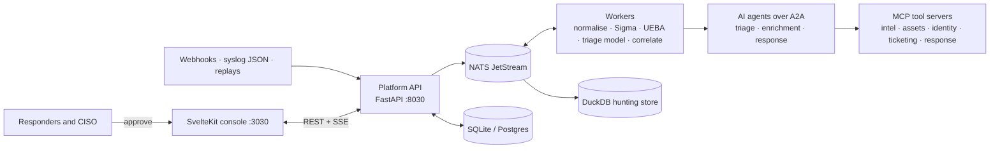

# Nightjar SOC

**AI security operations for mid-size companies, with regulatory incident reporting.**

Nightjar SOC watches a company's security events around the clock, groups alerts into incidents, separates real
threats from noise, has cooperating AI colleagues investigate each incident, and, when something serious
happens, starts the regulator's clock: EU **NIS2** (24 h / 72 h / one month), US **SEC Form 8-K Item 1.05** (four
business days) and Australia's **SOCI Act** (12 h / 72 h). People approve every disruptive response action.

> Status: under construction. Platform skeleton, contracts, data plan and toolchain checks are in place; the
> pipeline, agents, incident clock and console are being built against `docs/API_CONTRACT.md`.

## Why
Mid-size companies (200–2,000 people) face the same attackers as large ones with a fraction of the team, and now
answer to regulators on fixed clocks in every region they operate in. See [the problem statement](docs/PROBLEM_STATEMENT.md).

## What it does
- **Takes in events** from webhooks, syslog-style JSON and file replays; normalises them to one ECS-like schema.
- **Detects and groups**: open Sigma rules mapped to MITRE ATT&CK, per-person and per-machine behaviour baselines
  (Isolation Forest), correlation into incidents.
- **Triages with machine learning**: a calibrated gradient-boosted classifier scores every alert with
  plain-language reasons and suppresses false-positive storms.
- **Investigates with three AI colleagues** (triage, enrichment, response) that talk over the A2A protocol and use
  tools through MCP servers with least-privilege scopes. Every step is recorded and replayable.
- **Keeps humans in charge**: containment needs a responder's approval, crown-jewel systems also the CISO's.
- **Runs the incident clock**: proposes applicable regimes, counts down each deadline, drafts notices, records
  (mock) submissions.
- **Hunting and reporting**: saved searches over DuckDB, suggested hunts, an executive posture view and a weekly brief.

## Architecture



More in [docs/ARCHITECTURE.md](docs/ARCHITECTURE.md) and the [decision records](docs/adr/).

## Quick start (macOS / Linux, offline)
Requirements: Python 3.13, Node 21.7, `brew install libomp` on macOS. No Docker, no accounts, no keys.

```bash
make setup     # venv + pinned deps, web deps, nats-server into .tools/, .env, migrate, seed
make dev       # NATS :4230 · API :8030 · workers · agents :8031-8033 · tool servers :8034 · web :3030
make smoke     # re-verify NATS JetStream, A2A, MCP, Sigma, DuckDB and the ML stack on this machine
make test lint typecheck eval
```
Demo users (password `Nightjar-demo-2025!`): `ingrid.vos@halden.example` (CISO), `marcus.bell@halden.example`
(responder), `aiko.tanaka@halden.example` (analyst), `pieter.claes@halden.example` (admin),
`samira.haddad@halden.example` (auditor). Set `NIGHTJAR_DEMO_TODAY=2025-11-20` to view the demo as of that day.

## Measured so far (toolchain checks on an 8 GB MacBook, Python 3.13)
| Check | Result |
|---|---|
| NATS JetStream | durable consumers, redelivery on nak and ack timeout, dead-letter via max-deliveries advisory, discard-new backpressure; server ~23 MB RAM |
| A2A (`a2a-sdk` 1.3) | two agents with Agent Cards exchange a delegated task; peer-token gate; in-process transport |
| MCP (`mcp` 2.3) | scoped bearer tokens enforced inside the server; destructive tool refused without approval token |
| Sigma (pySigma 2.1) | 745/745 SigmaHQ rules compile; modifiers, correlation rules; ~31k events/s on a 7-rule set |
| DuckDB 2.0 | 50k events in 0.8 MB; time-bucket + window query in 24 ms |
| ML | Isolation Forest precision@20 = 1.00 on injected anomalies; LightGBM + calibration + SHAP run locally |

Evaluation results (detection, UEBA, triage, agent accuracy, time-to-triage, safety) will be in `eval/RESULTS.md`.

## Screenshots
_Placeholder: added once the console is built._

## Data
Public and synthetic only: OTRF Security Datasets, SigmaHQ rules (DRL 1.1), MITRE ATT&CK v18.1, CISA KEV (CC0).
Details and licences in [docs/DATA.md](docs/DATA.md).

## Limitations
Containment is simulated against the inventory; regulator submissions are recorded, not sent; the product
supports, but does not make, significance and materiality decisions; it is aligned with, not certified against,
any framework.

## Licence
MIT
