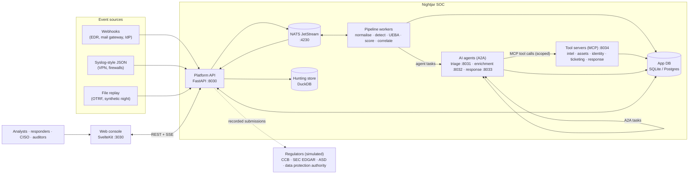
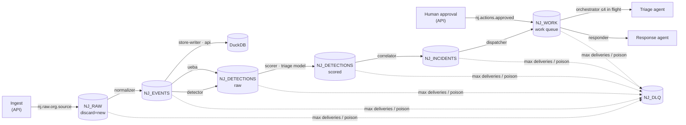
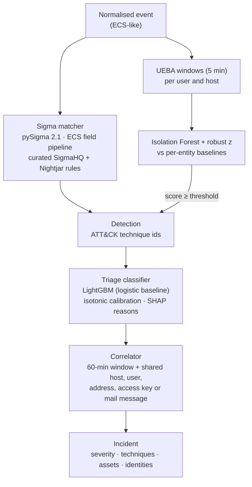
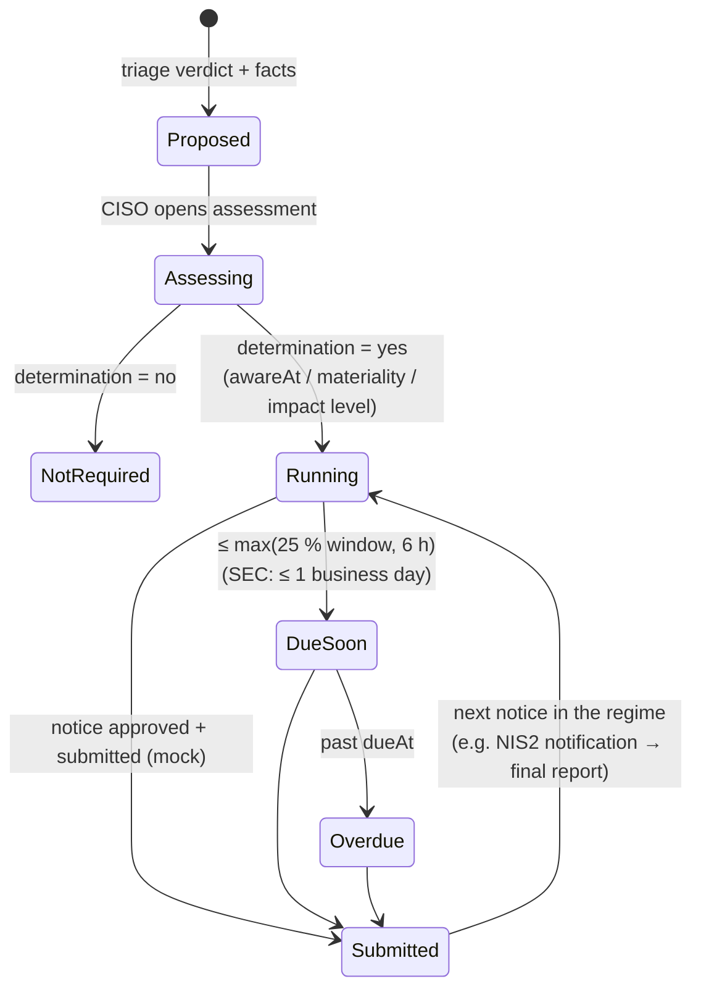

# Architecture

Nightjar SOC is an event-driven system: a NATS JetStream backbone carries events from intake through
normalisation, detection, scoring and correlation to incidents; three independent AI agents investigate incidents
by talking to each other over the A2A protocol and using tools through MCP servers; a FastAPI platform owns the
system of record, the human approval gate, the regulator clocks and the hunting store; a SvelteKit console shows
it all live over Server-Sent Events. Everything runs on one laptop, offline, with deterministic fakes for the
language model.

## System context



## Event flow and backbone



- **Backpressure** starts at the edge: the raw stream is byte-limited with discard-new, so a flood turns into
  `503 intake_full` + `Retry-After` for senders instead of unbounded memory. Every consumer bounds its in-flight
  work (`max_ack_pending`) and pulls in batches.
- **Retries** use per-consumer backoff; permanent failures go straight to the dead-letter stream; exhausted
  retries are moved there by the max-deliveries advisory. All handlers are idempotent.
- **Tests and single-process demos** use an in-process bus with the same interface (`BUS=memory`).

Details: API contract Part 4, ADR 0001.

## Detection, behaviour and triage



- **Sigma**: rules are parsed by pySigma and compiled to Python matchers; a processing pipeline maps Sigma's
  Windows field names onto Nightjar's schema; correlation rules (event/value counts) are supported. The active set
  is 125 curated SigmaHQ rules plus 18 of Nightjar's own. ADR 0003.
- **UEBA**: per-entity baselines (median/MAD with a floor, p95) and an Isolation Forest over login, process and
  network features; anomalies become `source="ueba"` detections with plain reasons. ADR 0005.
- **Triage model**: trained on labelled synthetic replay days with a time split; scores every detection with a
  calibrated probability and the top three SHAP reasons; likely-noise detections are suppressed from paging but
  kept, and an incident made only of noise is marked "likely benign". ADR 0005.
- **Correlation**: a detection joins an open cluster when it falls inside the cluster's 60-minute window and shares
  a host, a user (only from detections naming at most five users, so a spray across 63 accounts does not glue
  unrelated incidents together), an address, an access key or a mail message; a detection that links two clusters
  merges them. A cluster becomes an incident on one unsuppressed high-severity detection, two unsuppressed
  medium ones, or a storm of detections (one likely-benign incident instead of 146 alerts).

## Agents and tools

```mermaid
sequenceDiagram
  autonumber
  participant O as Orchestrator (workers)
  participant T as Triage agent (A2A)
  participant E as Enrichment agent (A2A)
  participant R as Response agent (A2A)
  participant M as Tool servers (MCP)
  participant P as Platform API
  participant H as Responder / CISO
  O->>T: triage_incident {incidentId}
  T->>P: get_incident_context (read)
  T->>M: identity.sign_in_profile, assets.get_asset (scoped)
  T->>E: enrich_incident {indicators, techniques}
  E->>M: intel.lookup_indicator, intel.lookup_kev, assets.asset_exposure
  E-->>T: enrichment
  T->>T: verdict (policy + calibrated score + narration)
  T->>R: plan_response {verdict}
  R->>M: response.propose_action (no execution)
  M->>P: request_approval
  R-->>T: plan (pending approvals)
  T-->>O: verdict artifact
  Note over P,H: Every step above is appended to the run's step log
  H->>P: Hold to authorise (responder; + CISO for crown jewels)
  P->>O: nj.actions.approved {approvalId}
  O->>R: execute_action {approvalId}
  R->>M: response.isolate_host {approvalToken}
  M->>P: verify token · consume nonce · effector · record_result
```

- **A2A** (official `a2a-sdk`, protocol 1.0, JSON-RPC): each agent is its own service with an Agent Card; calls
  between agents carry a peer token and each agent accepts only the callers it should. ADR 0002.
- **MCP** (official `mcp` SDK): five tool servers behind one host; bearer tokens map to per-agent scopes, enforced
  inside the server. Triage and enrichment can only read; only the response agent can propose or execute, and
  execution needs a human-issued, single-use approval token. ADR 0002, ADR 0006.
- **Language model**: LiteLLM to free cloud tiers when keys are present; a deterministic offline fake by default.
  The model narrates and ranks; policy code chooses tools and targets. Untrusted log text is neutralised and
  quoted. ADR 0006.

## Incident clock



Four regimes are modelled: EU NIS2 (24 h early warning, 72 h notification, final report one month after the
notification), SEC Form 8-K Item 1.05 (17:30 New York time on the fourth business day after the materiality
determination), Australia's SOCI Act (12 h critical, 72 h other) and GDPR Art. 33 (72 h). Regimes, deadlines and
notice types: API contract §1.12. Deadlines are computed from the determination timestamp
in UTC and shown in the regime's zone; SEC deadlines count US business days with a bundled federal-holiday table.

## Stores

| Store | Technology | Owner process | Contents |
|---|---|---|---|
| App database | SQLAlchemy 2 + Alembic; SQLite (WAL) by default, Postgres-ready | API, workers, agents (shared) | Tenancy, users, incidents, detections, runs and steps, approvals, notices, audit chain, SSE outbox |
| Hunting store | DuckDB (embedded, columnar) | **API only** (single writer) | Normalised events for search, hunting and the event river; Parquet snapshots for training |
| Stream store | JetStream file store in `data/jetstream` | nats-server | In-flight messages, dead letters |
| Experiment tracking | MLflow local tracking store in `mlruns/` (git-ignored) | `make train` | Runs, metrics, model versions; the committed `ml/artifacts/registry.json` records champion and challengers |

## Platform

- **Tenancy**: every table carries `org_id`; every query filters on the caller's active org; other orgs' ids
  return 404; agents read incident context through a tenant-checked function.
- **Auth**: Argon2id, server-side cookie sessions (30 min idle, 12 h absolute), double-submit CSRF, sign-in
  lockout, rate limits, security headers, RFC 7807 errors, request ids, structured logs with redaction.
- **RBAC**: admin, CISO/executive, responder, analyst, auditor; separation of duties for approvals and notices.
- **Audit**: per-org SHA-256 hash chain with a unique (org, previous hash) constraint so concurrent writers from
  different processes cannot fork it; agents and workers append as `agent`/`system` actors.
- **Live updates**: an outbox table any process can append to inside its own transaction; the API tails it per
  org and streams SSE with resume.
- **Demo clock**: `NIGHTJAR_DEMO_TODAY` shifts "today" for seed, countdowns and copy; security timers use real
  time.

## Processes and resources (8 GB laptop)

| Process | Port | Memory budget (approx.) |
|---|---|---|
| nats-server | 4230 (monitor 8230) | ~25 MB |
| API (FastAPI + DuckDB writer) | 8030 | ~250 MB |
| Workers (pipeline, ML scoring) | – | ~300 MB |
| Agents (one process hosting all three by default; `serve triage\|enrichment\|response` runs one each) | 8031–8033 | ~80 MB per agent process |
| Tool servers (MCP host) | 8034 | ~90 MB |
| Web (SvelteKit) | 3030 | ~150 MB dev |

## Decisions
- [ADR 0001](adr/0001-nats-jetstream-backbone.md) NATS JetStream as the event backbone
- [ADR 0002](adr/0002-a2a-agents-mcp-tools-least-privilege.md) A2A agents, MCP tools and least privilege
- [ADR 0003](adr/0003-sigma-evaluation.md) Sigma evaluation with pySigma's native matcher
- [ADR 0004](adr/0004-duckdb-hunting-store.md) DuckDB hunting store with a single writer
- [ADR 0005](adr/0005-ml-triage-and-ueba.md) Classical ML: UEBA and the triage classifier
- [ADR 0006](adr/0006-human-approval-and-injection-defence.md) Human approval for response and the prompt-injection defence
